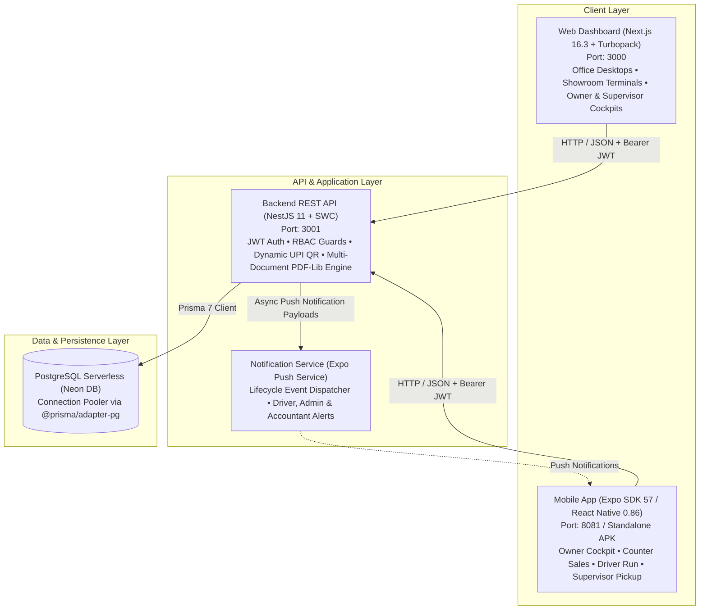

# Shree Om Tiles ERP (DhraERP) 🏗️📦

> **Enterprise-Grade, Multi-Platform Tile & Building Material Wholesale ERP**  
> Unified fullstack suite featuring real-time tile inventory across multiple warehouses, B2B sales invoicing with upfront NPCI UPI QR code generation, procurement & vendor purchase orders with debit notes, price estimates with 1-click invoice conversion, categorized daily business expenses, daily till book cash reconciliation, automated GSTR-1 & GSTR-3B tax reporting, godown supervisor cockpits with price masking and loading verification, unpriced delivery challans, end-to-end logistics & dispatch tracking, driver collection reconciliation, party statement ledgers, real-time push notifications, and executive analytics.

[](file:///d:/code/Projects/dhraERP/backend)
[](file:///d:/code/Projects/dhraERP/web-dashboard)
[](file:///d:/code/Projects/dhraERP/mobile-app)
[](https://reactnative.dev)
[](file:///d:/code/Projects/dhraERP/backend/prisma)
[-4169E1?logo=postgresql&logoColor=white)](https://neon.tech)
[](https://www.typescriptlang.org/)

---

## 📑 Table of Contents
1. [System Architecture Overview](#system-architecture-overview)
2. [Monorepo Directory Layout](#monorepo-directory-layout)
3. [Core Business Domains](#core-business-domains)
4. [Automated Push Notification Triggers](#automated-push-notification-triggers)
5. [Role-Based Access Control (RBAC)](#role-based-access-control-rbac)
6. [Ports & Network Topography](#ports--network-topography)
7. [Prerequisites & Dependencies](#prerequisites--dependencies)
8. [Quickstart Guide](#quickstart-guide)
9. [Seed Credentials & Demo Accounts](#seed-credentials--demo-accounts)
10. [Automated Multi-Role E2E Testing Suite](#automated-multi-role-e2e-testing-suite)
11. [Over-The-Air (OTA) Instant Mobile Updates](#over-the-air-ota-instant-mobile-updates)
12. [Component Documentation Links](#component-documentation-links)

---

## 🏛️ System Architecture Overview



---

## 📁 Monorepo Directory Layout

```
dhraERP/
├── backend/                  # NestJS 11 core REST API & microservices
│   ├── prisma/               # Prisma 7 schema definitions, seed scripts, clean-test-db & CSV importer
│   ├── src/
│   │   ├── analytics/        # Financial KPIs, revenue curves, Day Book till cash, GST reports
│   │   ├── auth/             # Passport JWT auth, hashing & RBAC guards
│   │   ├── delivery/         # Logistics manifests, driver assignments, cash settlement, challans
│   │   │   └── pdf/          # Delivery Challan PDF generator (unpriced logistics document)
│   │   ├── expenses/         # Categorized overheads (fuel, hamali, rent, utilities, advances)
│   │   ├── invoices/         # Invoicing engine, upfront UPI QR, PDF generator, sales returns, deletion
│   │   │   └── pdf/          # High-precision Tax Invoice & Credit Note PDF generators
│   │   ├── notifications/    # Expo Push service dispatcher & multi-role broadcast
│   │   ├── parties/          # Customer & vendor ledgers, balance math
│   │   │   └── pdf/          # Official Party Statement ledger PDF generator with date filtering
│   │   ├── payments/         # Payment collection, receipting & reconciliation
│   │   ├── prisma/           # Prisma client singleton with Neon pooler adapter
│   │   ├── products/         # Tile inventory, dimensions, sq.ft / box conversion, supervisor masking
│   │   ├── purchases/        # Inward procurement, vendor bills, inventory replenishment, debit notes
│   │   ├── quotations/       # Price estimates, quotes, vector PDF generator, 1-click invoice conversion
│   │   │   └── pdf/          # Estimate / Quotation PDF generator
│   │   ├── settings/         # Company profile, UPI accounts, GSTIN configuration
│   │   ├── stock/            # Multi-warehouse stock inward, adjustments & transfers (positiveOnly filter)
│   │   ├── users/            # Employee management, roles, push token storage, warehouse scopes
│   │   └── warehouses/       # Physical godown & showroom locations
│   └── README.md             # Detailed Backend documentation
│
├── web-dashboard/            # Next.js 16.3 (Turbopack, App Router) Web ERP
│   ├── app/                  # App Router pages (/dashboard, /day-book, /deliveries, /expenses, /invoices, /purchases, /quotations, /warehouses, ...)
│   ├── components/           # Reusable UI modules, drawers, dialogs, analytics widgets, supervisor cockpit
│   ├── lib/                  # API client with real-time cache invalidation, token management, currency formatting
│   └── README.md             # Detailed Web Dashboard documentation
│
├── mobile-app/               # Expo SDK 57 / React Native 0.86 Mobile ERP
│   ├── src/
│   │   ├── app/              # Expo Router tab routes (dashboard, invoices, transactions, stock, deliveries, more)
│   │   ├── components/       # Componentized domain modules:
│   │   │   ├── dashboard/    # Specialized cockpits (Owner, Salesman, Driver, Supervisor)
│   │   │   ├── day-book/     # Daily Till Book view with date switcher
│   │   │   ├── deliveries/   # Manifest cards, push dispatch modals, challan buttons, driver assigners
│   │   │   ├── expenses/     # Categorized expense view & creation modals
│   │   │   ├── invoices/     # List cards, line-item cards, upfront UPI modal, delete invoice modal, returns
│   │   │   ├── parties/      # Directory view, statement drawer with date filters, category badges
│   │   │   ├── payments/     # Transaction tabs, customer dues, store payables, settlement modals
│   │   │   ├── purchases/    # Vendor purchase order list, debit notes & CreatePurchaseModal
│   │   │   ├── quotations/   # Estimates directory, PDF preview, 1-click convert & CreateQuotationModal
│   │   │   ├── settings/     # Staff directory (Accountant/Supervisor roles), UPI cards, company profile
│   │   │   ├── stock/        # Tile catalog cards, warehouse stock breakdown, inward/transfer modals
│   │   │   ├── ui/           # BottomSheetModal, Header, custom Select, badges, buttons
│   │   │   └── warehouses/   # Warehouse directory, positive stock (> 0) filtering, danger action modals
│   │   └── lib/              # API client, auth context, push notification listener, PDF & WhatsApp utils
│   ├── app.json              # Expo application configuration & notification plugin
│   ├── eas.json              # EAS cloud build & OTA update profiles
│   └── README.md             # Detailed Mobile Application documentation
│
├── scripts/                  # Data import scripts
│   └── inventory_master.csv  # Tile master catalog data for bulk import
│
└── README.md                 # Root Monorepo master documentation (this file)
```

---

## 💼 Core Business Domains

### 1. Tile Inventory & Multi-Warehouse Operations
- Engineered specifically for tile wholesaling where products are stored and counted in **Boxes**, but quoted, billed, and measured in **Square Feet** (`sq. ft.`).
- Real-time stock visibility broken down by individual warehouses and showrooms.
- Stock adjustments, inward stock receipting, and inter-godown transfers with automatic inventory integrity validation.
- Live decrementation on invoice generation, with automated restock on sales returns and invoice deletions.

### 2. Inward Procurement & Vendor Purchases (`/purchases`)
- Complete vendor purchasing pipeline with sequential bill numbering (`PUR-2627-0001`).
- Automatic inventory addition directly into targeted warehouses.
- Issuance of **Debit Notes** (`DN-2627-0001`) for damaged or returned goods with automatic supplier ledger adjustment.

### 3. Price Estimates & Quotations (`/quotations`)
- Generate formal quotations (`EST-2627-0001`) with expiration dates, line discounts, transport charges, and taxes.
- Download branded estimate PDFs or share directly on WhatsApp.
- **1-Click Convert to Invoice**: Seamlessly promotes quotes to active tax invoices without re-typing line items.

### 4. Daily Till Book / Day Book (`/analytics/day-book`)
- Real-time counter cash till reconciliation:
  - **Opening Cash** carried forward from previous sessions.
  - **Cash Inflows** (cash billing & customer collections).
  - **Cash Outflows** (supplier payments & cash expenses).
  - **Digital Inflows** (tracked separately for UPI & Bank Transfers).
  - **Net Daily Cash Flow** and verified **Closing Till Balance**.
- Historical calendar date navigation to inspect any day's financial activity.

### 5. Automated GST Analytics (`/analytics/gst-reports`)
- **GSTR-1**: Automatic separation of sales into B2B (with party GSTIN) and B2C, complete with taxable amounts and CGST/SGST/IGST breakdown.
- **GSTR-3B**: Calculation of outward taxable supplies, inward purchases with Input Tax Credit (ITC) eligibility, and net tax payable.

### 6. Warehouse Supervisor Cockpit & Loading Verification
- Dedicated godown supervisor views on Web and Mobile scoped to the supervisor's assigned warehouse.
- **Strict Price Masking**: Tile purchase rates, selling prices, and invoice profit margins are hidden from supervisors.
- **Loading Checklist**: Drivers cannot pick up items on their own; godown supervisors inspect items and tap **Confirm Pick**, permanently locking the verification with an immutable supervisor timestamp.

### 7. Unpriced Delivery Challans (`/delivery/:id/challan-pdf`)
- Generates official delivery challans designed for transport drivers and warehouse dispatchers.
- Highlights items, packaging units, vehicle numbers, and signature blocks while omitting commercial pricing details.

### 8. Safe Transactional Invoice Deletion (`DELETE /invoices/:id`)
- Restricted strictly to `OWNER` and `ADMIN`.
- Atomically restores deducted inventory with row-level locking (`SELECT ... FOR UPDATE`).
- Cascades cleanup across delivery runs, trips, payments, and credit ledgers in a single ACID transaction with audit logging.

### 9. Upfront NPCI Dynamic UPI QR Engine
- Generates dynamic payment QR codes conforming strictly to National Payments Corporation of India (NPCI) standards:  
  `upi://pay?pa={UPI_ID}&pn={MERCHANT}&am={AMOUNT}&cu=INR&tn={INVOICE_NO}`
- Rendered on the fly as high-contrast QR codes inside counter billing dialogs, counter UPI scan modals, and embedded directly onto official PDF invoices.

### 10. Double-Entry Party Ledgers & Balance Math
- Complete double-entry accounting separating **Net Pending Dues** from **Advance / Store Credit Balances**.
- Categorize parties into `RETAIL`, `CONTRACTOR`, `ARCHITECT`, and `WHOLESALER`.
- Date-filtered statement export to high-precision printable PDF documents.
- Overdue credit ageing analysis categorized into `0-30`, `31-60`, `61-90`, and `90+` days.

---

## 🔔 Automated Push Notification Triggers

The system includes a centralized push notification infrastructure powered by **Expo Push Service**:

| Event Trigger | Recipient Group | Notification Content | Payload Data |
|:---|:---|:---|:---|
| **1. New Invoice Created** | Owner, Admins & Accountants | `New Invoice Created: {invoiceNo}` (`₹{amount}` billed to `{customer}`) | `{ type: 'INVOICE_CREATED', invoiceId }` |
| **2. Payment Recorded** | Owner, Admins & Accountants | `Payment Collected: ₹{amount}` (Mode: `{mode}` from `{customer}`) | `{ type: 'PAYMENT_RECEIVED', paymentId }` |
| **3. Credit Note / Sales Return** | Owner, Admins & Accountants | `Credit Note Issued: ₹{refund}` refunded for `{invoiceNo}` | `{ type: 'CREDIT_NOTE', invoiceId }` |
| **4. Low Stock Alert** | Owner & Admins | `Low Stock Alert`: Product `{name}` has dropped below threshold | `{ type: 'LOW_STOCK', productId }` |
| **5. Delivery Assigned** | Assigned Driver | `New Delivery Assigned`: Invoice `{invoiceNo}` to `{customer}` | `{ type: 'DELIVERY_ASSIGNED', deliveryOrderId }` |
| **6. Trip In-Transit** | Owner & Admins | `Trip In-Transit`: `{driver}` started delivery for `{invoiceNo}` | `{ type: 'TRIP_IN_TRANSIT', deliveryOrderId }` |
| **7. Delivery Completed** | Owner & Admins | `Delivery Completed`: `{invoiceNo}` delivered to `{customer}` | `{ type: 'DELIVERY_COMPLETED', deliveryOrderId }` |
| **8. Delivery Cancelled** | Owner & Admins | `Delivery Cancelled`: `{invoiceNo}` - reason: `{reason}` | `{ type: 'DELIVERY_CANCELLED', deliveryOrderId }` |

---

## 🛡️ Role-Based Access Control (RBAC)

The system enforces strict permission boundaries at the NestJS API layer (`@Roles(...)` decorator + `RolesGuard`) and dynamically adapts client user interfaces across Web and Mobile:

| Feature / Domain | OWNER | ADMIN | ACCOUNTANT | SUPERVISOR | SALESMAN | DRIVER |
|:---|:---:|:---:|:---:|:---:|:---:|:---:|
| **Analytics & Gross Margin Reports** | ✅ Full Access | ✅ Full Access | ✅ Full Access | ❌ Hidden | ❌ Hidden | ❌ Hidden |
| **Daily Till Book (Day Book)** | ✅ Full Access | ✅ Full Access | ✅ Full Access | ❌ Hidden | ❌ Hidden | ❌ Hidden |
| **GST Reports (GSTR-1 & GSTR-3B)** | ✅ Full Access | ✅ Full Access | ✅ Full Access | ❌ Hidden | ❌ Hidden | ❌ Hidden |
| **Company Settings & UPI Accounts** | ✅ Full Access | ❌ Hidden | ❌ Hidden | ❌ Hidden | ❌ Hidden | ❌ Hidden |
| **Staff & User Role Directory** | ✅ Full Access | ❌ Hidden | ❌ Hidden | ❌ Hidden | ❌ Hidden | ❌ Hidden |
| **Inward Purchases & Debit Notes** | ✅ Full Access | ✅ Full Access | ✅ Full Access | 👁️ View Only | ❌ Hidden | ❌ Hidden |
| **Price Estimates & Quotations** | ✅ Full Access | ✅ Full Access | ✅ Full Access | ❌ Hidden | ✅ Create / Convert | ❌ Hidden |
| **Business Expenses Logging** | ✅ Full Access | ✅ Full Access | ✅ Full Access | ❌ Hidden | ❌ Hidden | ❌ Hidden |
| **Party Directory & Statements** | ✅ Full Access | ✅ Full Access | ✅ Full Access | ❌ Hidden | ✅ View / Create | ❌ Hidden |
| **Create Invoices & Upfront UPI QR** | ✅ Full Access | ✅ Full Access | ✅ Full Access | ❌ Hidden | ✅ Full Access | ❌ Hidden |
| **Safe Invoice Deletion & Restock** | ✅ Full Access | ✅ Full Access | ❌ Hidden | ❌ Hidden | ❌ Hidden | ❌ Hidden |
| **Process Returns / Credit Notes** | ✅ Full Access | ✅ Full Access | ✅ Full Access | ❌ Hidden | ✅ Full Access | ❌ Hidden |
| **Warehouse Stock Management** | ✅ All Godowns | ✅ All Godowns | 👁️ View Only | 🔒 Scoped Godown | 👁️ View Only | ❌ Hidden |
| **Warehouse Item Pickup Check** | ✅ Full Access | ✅ Full Access | ❌ Hidden | 🔒 Scoped Godown | ❌ Hidden | ❌ Locked |
| **Delivery Challan PDF Download** | ✅ Full Access | ✅ Full Access | ✅ Full Access | ✅ Full Access | ✅ Full Access | ✅ Full Access |
| **Trip Manifest & Status Updates** | ✅ Full Access | ✅ Full Access | 👁️ View Only | 👁️ View Only | ❌ Hidden | ✅ Dedicated View |
| **On-Site Payment Collection** | ✅ Full Access | ✅ Full Access | ❌ Hidden | ❌ Hidden | ✅ Full Access | ✅ Cash & UPI |
| **Driver Cash Settlement Approval** | ✅ Full Approval | ✅ Full Approval | ❌ Hidden | ❌ Hidden | ❌ Hidden | ❌ Hidden |

---

## 🌐 Ports & Network Topography

| Service | Default Port | Local URL | Network / LAN Access |
|:---|:---:|:---|:---|
| **Backend REST API** | `3001` | `http://localhost:3001` | `http://<YOUR_PC_LAN_IP>:3001` |
| **Web Dashboard** | `3000` | `http://localhost:3000` | `http://<YOUR_PC_LAN_IP>:3000` |
| **Mobile Metro Bundler** | `8081` | `http://localhost:8081` | Expo Go / QR scan over LAN |

---

## ⚙️ Prerequisites & Dependencies

- **Node.js**: `v20.x` or `v22.x` (LTS recommended)
- **Package Manager**: `npm` (v10+)
- **Database**: PostgreSQL (Pre-configured Neon Serverless Postgres pooler)
- **Mobile Development / Testing**:
  - Expo Go app on iOS or Android, OR
  - Standalone Android APK compiled via EAS Build

---

## 🚀 Quickstart Guide

### 1. Backend API Service

```bash
# Navigate to backend directory
cd backend

# Install dependencies
npm install

# Push Prisma schema to Neon PostgreSQL
npx prisma generate
npx prisma db push

# (Optional) Seed demo accounts, products, warehouses, parties
npx prisma db seed

# Start NestJS backend with fast SWC compiler
npm run start:dev
```
*API live at `http://localhost:3001`.*

---

### 2. Web Dashboard

```bash
# Navigate to web dashboard directory
cd web-dashboard

# Install dependencies
npm install

# Start Next.js with Turbopack
npm run dev
```
*Web ERP live at `http://localhost:3000`.*

---

### 3. Mobile Application

```bash
# Navigate to mobile app directory
cd mobile-app

# Install dependencies
npm install

# Start Expo Metro Bundler (clearing cache)
npx expo start -c
```
*Scan the terminal QR code with Expo Go or Camera app.*

---

## 🔑 Seed Credentials & Demo Accounts

| Role | Mobile / Username | Password | Dedicated Interface |
|:---|:---|:---|:---|
| **Owner / Admin** | `9828920964` | `admin123` | Executive KPI cockpit, Cash settlement approvals, Day Book, Company settings |
| **Supervisor** | `9876543213` | `super123` | Godown cockpit, Loading pickup checklist, Masked pricing |
| **Salesman** | `9876543211` | `sales123` | Rapid counter billing, Instant UPI QR modal, Estimates, Party statements |
| **Driver** | `9876543212` | `driver123` | Road cockpit, Manifest list, Delivery challans, Payment logging |


## ⚡ Over-The-Air (OTA) Instant Mobile Updates

The mobile app includes instant Over-The-Air (OTA) update publishing via `expo-updates` and EAS Update. Code changes and fixes can be deployed to production mobile users instantly without compiling new APKs:

```bash
cd mobile-app
eas update --branch production --environment production --message "feat: mobile quotations, purchases, zero-stock filtering & transaction sync" --non-interactive
```

- **Runtime Version**: `"policy": "appVersion"`
- **Distribution Channels**: `production`, `preview`, `development`

---

## 📖 Component Documentation Links

For deep-dive documentation on each subsystem:

- ⚙️ **[Backend Architecture & REST API Reference](file:///d:/code/Projects/dhraERP/backend/README.md)**
- 💻 **[Web Dashboard Technical Guide](file:///d:/code/Projects/dhraERP/web-dashboard/README.md)**
- 📱 **[Mobile Application & EAS Android Build Guide](file:///d:/code/Projects/dhraERP/mobile-app/README.md)**

